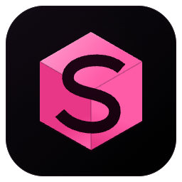
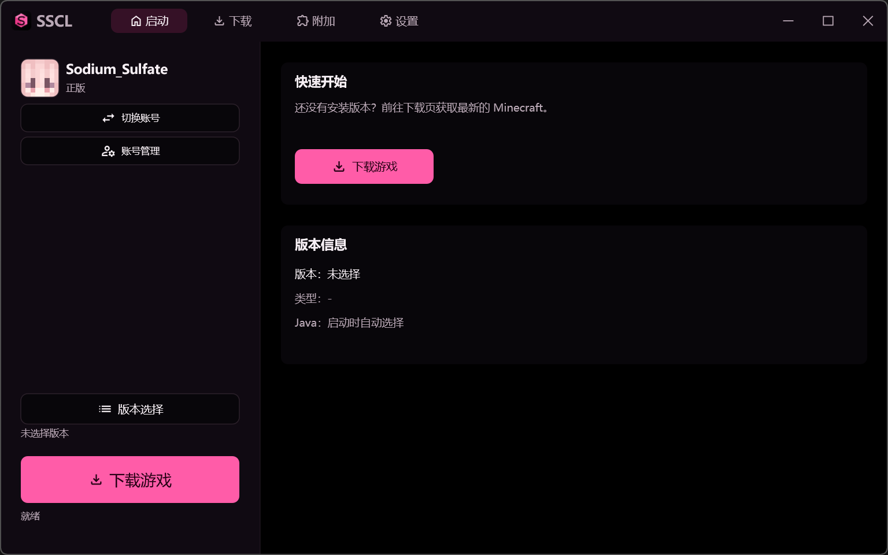

<div align="center">
  
  <h1>SSCL</h1>
  <p><strong>Sodium Sulfate Craft Launcher</strong></p>
  <p>使用 C++20 + Win32 + Direct2D/DirectWrite 自绘的 Minecraft Java 版启动器</p>
  <p>
    <a href="https://www.microsoft.com/windows"></a>
    <a href="https://isocpp.org/"></a>
    <a href="https://www.minecraft.net/"></a>
    <a href="LICENSE"></a>
    <a href="../../releases"></a>
  </p>
</div>



<p align="center"><sub>深色主题主界面</sub></p>

> **Beta 测试阶段 · 当前版本 0.1.0**
>
> SSCL 目前处于 Beta 测试阶段，Bug 尚未完全发现和修复。版本行为、配置格式与界面仍可能调整；请勿把唯一一份重要游戏数据放在测试实例中，升级前建议备份 `SSCL\` 数据目录。

## 简介

SSCL 是一个面向 Windows 的 Minecraft Java 版启动器，目标是把版本管理、账号登录、加载器安装、Mod 与整合包管理集中在一个干净的原生界面里。

发布形态为**单个 EXE**：无安装器、无附带 DLL、无外置资源目录，图标与界面资源全部内嵌。

## 特点

- **体积小巧**：发布版单个 `SSCL.exe` 约 2.7 MB，不依赖 VC++ 运行库 DLL。

## 功能状态

| 模块 | 状态 | 说明 |
|---|---|---|
| 版本与实例 | 可用 | Mojang 版本清单、原版下载、完整性校验、`inheritsFrom` 合并、版本隔离、多 `.minecraft` 文件夹；实例卡片、收藏、隐藏、重命名、删除（含依赖保护） |
| 启动与 Java | 可用 | JVM/游戏参数拼装、`rules` 规则、占位符、natives 解压、`@argfile`、启动准备阶段取消；六类 Java 来源检测、手动路径、版本范围、自动下载 Temurin JRE |
| 启动前命令 | **部分实现** | 仅支持单条命令，经 `cmd.exe /c` 在实例运行目录执行；可切换“等待执行完成”；没有多命令、输出捕获、超时或占位符替换 |
| 账号与皮肤 | 可用 | 离线账号；微软正版登录（设备码 + PKCE 回环 + 静默续登，DPAPI）；外置登录（authlib-injector，如 LittleSkin）；Yggdrasil 皮肤解析与头像展示 |
| 加载器 | **部分实现** | Fabric、Forge、NeoForge 一键安装（含 processors）；Quilt、OptiFine 仅识别，不支持一键安装 |
| Mod 管理 | 可用 | Modrinth、CurseForge 搜索、详情、版本列表、依赖解析、一键安装；本地扫描、启用/禁用、删除 |
| Mod 更新 | **部分实现** | 支持手动“检查更新 / 应用更新”；只替换 Mod 主文件，不处理依赖更新；启动时自动检查尚未接入，实例设置里的“跳过 Mod 更新检查”暂不产生实际效果 |
| 整合包 | **部分实现** | 支持 `.mrpack` / CurseForge `manifest.json` 的文件列表导入到**已存在**的匹配实例；不会自动安装 Minecraft 或加载器；不处理 `overrides/`、`client-overrides/`；导出为通用 ZIP（`versions/<id>` + `mods`），不是标准整合包格式 |
| 下载 | 可用 | 文件级自适应并发、单文件 2/4/6 线程 Range 分块、镜像回退、重试、源禁用冷却、全局限速、SHA1/MD5 校验 |
| 界面与任务日志 | 部分实现 | 深/浅主题、四档动效、启动画面、无边框自绘窗口、高 DPI、首启向导、Ctrl+V/C/X；任务页提供下载/安装过程终端日志；**不提供游戏 stdout / 游戏日志实时查看** |

## Beta 阶段说明

- 核心链路（版本下载、启动、账号、Java、Fabric/Forge/NeoForge 安装）已可用于日常测试，但不代表已经稳定。
- 上表标记为“部分实现”的功能属于**基础可用**，边界和交互仍会调整，不应按“完整功能”预期。
- 启动前命令、游戏实时日志、Mod 自动更新、整合包完整导入/导出仍在开发中。
- 目前没有遥测或自动崩溃上报；遇到问题时请手动附上日志与复现步骤。

## 快速开始

1. 从 Releases 下载 `SSCL.exe`，放到任意可写目录。
2. 启动后按首次向导选择游戏目录、Java 与下载源。
3. 在「下载」中选择 Minecraft 版本，或在「版本选择」中导入已有实例。

启动器使用便携模式：配置、账号、日志、缓存、Java 与游戏文件都保存在 **EXE 同目录的 `SSCL\`**，不写注册表。

## 系统要求

- Windows 10 1809 及以上 / Windows 11，x64
- 运行游戏需要 Java；启动器会根据版本元数据选择，缺失时尝试自动下载 Temurin JRE
- 网络：Mojang / BMCLAPI、Modrinth、CurseForge（可选 Key）

## 数据与隐私

- 账号令牌、用户填写的 CurseForge Key 使用 Windows DPAPI 加密，仅当前 Windows 用户可解密。
- 日志会对 `access_token`、`refresh_token`、API Key 等字段脱敏。
- 不包含遥测、广告、统计或自动崩溃上报；不会把本地日志、游戏目录或账号数据上传到自建服务器。
- 完整说明见程序内「设置 → 关于 → 隐私政策」。

## 从源码构建

需要 Visual Studio 2026（v145 工具集）、Windows SDK、vcpkg manifest 依赖（`nlohmann-json`、`miniz`、`doctest`）。

```powershell
powershell -ExecutionPolicy Bypass -File .\scripts\build-release.ps1
```

产物输出到 `SSCL\dist\SSCL.exe`，并生成 SHA-256。脚本需要本地 `build-secrets.txt`（不随仓库分发）；测试工程可在 `SSCL\SSCL.slnx` 中单独构建 `SSCL.Tests`。

## 已知限制

- **启动前命令**：只支持单条 `cmd /c` 命令，无输出、无超时、无多命令编排；异步执行失败不会回显。
- **实时日志**：任务页显示下载/安装日志；游戏启动后的 stdout、Log4j 日志与控制台尚未接入启动器。
- **Mod 更新**：手动检查/应用；不更新依赖；启动时自动检查与“跳过 Mod 更新检查”开关尚未接通。
- **整合包**：只导入文件列表到已有实例，不安装 MC/加载器，不处理 `overrides`；导出是通用 ZIP。
- Quilt、OptiFine 目前仅识别，不支持一键安装。
- 资源包、光影、存档、截图管理、崩溃分析、自更新、多语言尚未实现。
- 皮肤目前用于头像展示，上传皮肤与披风切换未实现。
- 当前构建未做代码签名，Windows SmartScreen 可能提示“未知发布者”。

## 参与贡献

欢迎提交 Issue 与 Pull Request。Beta 阶段的问题反馈请尽量附上：

- SSCL 版本号与 Windows 版本；
- `SSCL\logs\` 中对应时间的日志；
- 复现步骤与预期/实际结果。

提交前请确认：

- 不提交 `build-secrets.txt`、账号数据、日志或任何真实密钥；
- 新增/删除源文件时同步维护 `.vcxproj` 与 `.filters`；
- 尽量补充或运行 `SSCL.Tests`，并在 PR 中说明验证方式。

## 许可

本项目以 **GNU Affero General Public License v3.0（AGPL-3.0）** 发布，完整文本见 [LICENSE](LICENSE)。

Copyright (C) 2026 Sodium_Sulfate_Studio.

如果你修改本项目并通过网络提供服务，需按 AGPL-3.0 向用户提供对应的完整源码。第三方组件分别适用其自身许可证，见 [SSCL/THIRD_PARTY_NOTICES.md](SSCL/THIRD_PARTY_NOTICES.md)。
